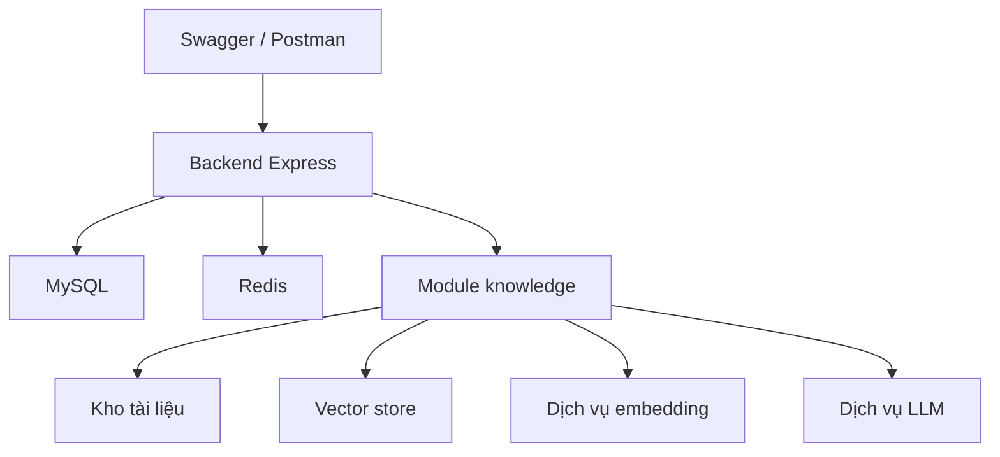

# Kiến trúc hệ thống

## 1. Mục đích

Tài liệu mô tả kiến trúc backend quản lý bán hàng và tồn kho đồ điện tử, bao gồm:

- Các thành phần của hệ thống.
- Cách phân chia module và trách nhiệm từng lớp.
- Luồng xử lý request.
- Cách quản lý transaction và truy cập dữ liệu.
- Tích hợp caching, embedding và RAG.
- Định hướng kiểm thử, đóng gói và CI/CD.

Đây là thiết kế mục tiêu, không phải xác nhận các thành phần đã được triển khai.

Tài liệu liên quan:

- [Phạm vi dự án](scope.md)
- [Quy tắc nghiệp vụ](business-rules.md)
- [Thiết kế cơ sở dữ liệu](database.md)
- [Mã nguồn ERD](diagrams/erd.dbml)

## 2. Lựa chọn kiến trúc

Hệ thống sử dụng kiến trúc **Modular Monolith**:

- Một ứng dụng backend Node.js/Express.
- Mã nguồn chia thành các module theo nghiệp vụ.
- Các module được phát triển và triển khai trong cùng ứng dụng.
- MySQL lưu dữ liệu nghiệp vụ.
- Redis phục vụ caching.
- Thành phần lưu vector và dịch vụ mô hình phục vụ embedding/RAG.

### 2.1. Lý do lựa chọn

- Phù hợp phạm vi một cửa hàng, một kho và thời gian thực hiện dự án.
- Dễ khởi chạy, kiểm thử và triển khai.
- Cho phép thực hiện transaction xuyên suốt đơn hàng và tồn kho trong một database.
- Giữ trách nhiệm các module rõ ràng để thuận tiện bảo trì.
- Đủ khả năng tích hợp caching và RAG mà không cần tách thành nhiều microservice.

Modular Monolith không có nghĩa mỗi module là một server hoặc container riêng.

## 3. Các thành phần chính

| Thành phần | Trách nhiệm |
|---|---|
| Swagger/Postman | Gửi request, kiểm tra và demo API |
| Express backend | Xác thực, phân quyền, validation và xử lý nghiệp vụ |
| MySQL | Lưu tài khoản, sản phẩm, chứng từ và tồn kho |
| Redis | Cache dữ liệu đọc phù hợp |
| Kho tài liệu | Lưu tài liệu nguồn phục vụ hỏi đáp |
| Vector store | Lưu vector và metadata phục vụ truy xuất ngữ nghĩa |
| Dịch vụ embedding | Chuyển đoạn tài liệu hoặc câu hỏi thành vector |
| Dịch vụ LLM | Sinh câu trả lời dựa trên nội dung truy xuất được |

`knowledge` là module bên trong backend, không phải một ứng dụng độc lập trong thiết kế hiện tại.

Nhà cung cấp mô hình, giải pháp lưu vector và nơi lưu tài liệu sẽ được chốt khi thiết kế module này.

## 4. Phân chia module

| Module | Trách nhiệm chính | Dữ liệu liên quan |
|---|---|---|
| `auth` | Đăng nhập và xác thực danh tính | `users` |
| `users` | Cấp/khóa tài khoản, đổi mật khẩu, cung cấp thông tin tài khoản | `users` |
| `catalog` | Quản lý sản phẩm và danh mục | `products`, `categories` |
| `suppliers` | Quản lý nhà cung cấp | `suppliers` |
| `inventory` | Truy cập tồn kho và tổng hợp lịch sử nhập/xuất | `inventory` và dữ liệu chứng từ |
| `purchasing` | Tạo, sửa, hủy và xác nhận phiếu nhập | `stock_receipts`, `stock_receipt_items` |
| `sales` | Tạo, sửa, hủy và xác nhận đơn bán | `sales_orders`, `sales_order_items` |
| `knowledge` | Ingest tài liệu, embedding, retrieval và hỏi đáp | Thiết kế dữ liệu riêng |

### 4.1. Nguyên tắc phối hợp

- Mỗi module chịu trách nhiệm chính cho nghiệp vụ và truy cập dữ liệu của mình.
- Module khác sử dụng các hàm nội bộ được cung cấp rõ ràng, không sao chép SQL của module sở hữu dữ liệu.
- Không gọi HTTP giữa các module trong cùng ứng dụng.
- Tránh phụ thuộc vòng giữa các module.
- Controller không gọi trực tiếp Repository.

Ví dụ:

- `sales` điều phối xác nhận đơn và gọi các hàm tồn kho của `inventory`.
- `purchasing` điều phối xác nhận phiếu và gọi các hàm cộng tồn.
- `catalog` phối hợp với `inventory` để tạo sản phẩm và tồn ban đầu bằng 0.
- `auth` lấy thông tin tài khoản qua chức năng do module `users` cung cấp.

Truy vấn lịch sử nhập/xuất được phép đọc nhiều nhóm bảng trong một thành phần truy vấn chuyên biệt. Không dùng luồng tra cứu này để cập nhật chứng từ.

## 5. Phân lớp bên trong module

| Thành phần | Trách nhiệm | Không đảm nhiệm |
|---|---|---|
| Router | Khai báo endpoint, gắn middleware và Controller | SQL, transaction |
| Middleware | Xác thực, kiểm tra quyền chung, xử lý lỗi và logging | Điều phối nghiệp vụ nhập/bán |
| Validator | Kiểm tra cấu trúc, kiểu và giới hạn dữ liệu đầu vào | Quyết định nghiệp vụ phụ thuộc dữ liệu hiện tại |
| Controller | Nhận dữ liệu hợp lệ, gọi Service, trả HTTP response | Viết SQL hoặc điều phối transaction |
| Service | Kiểm tra nghiệp vụ, quyền theo chứng từ, điều phối transaction | Phụ thuộc trực tiếp vào `req`, `res` |
| Repository | Thực hiện truy vấn và trả dữ liệu | Trả HTTP response hoặc tự quyết định quyền người dùng |

### 5.1. Validation và nghiệp vụ

Ví dụ với xác nhận đơn bán:

- ID phải là số nguyên dương: kiểm tra đầu vào.
- Người gọi phải đăng nhập: middleware xác thực.
- STAFF phải là người tạo đơn: Service kiểm tra.
- Đơn phải ở trạng thái `DRAFT`: Service kiểm tra.
- Tồn phải đủ và cập nhật an toàn khi đồng thời: Service phối hợp Repository trong transaction.

Các ràng buộc database tiếp tục bảo vệ dữ liệu ngay cả khi đã có validation.

## 6. Cấu trúc thư mục dự kiến

Các đường dẫn tính từ thư mục gốc repository.

| Đường dẫn | Nội dung |
|---|---|
| `src/app.js` | Tạo Express app, gắn middleware và router |
| `src/server.js` | Khởi động HTTP server và quản lý vòng đời ứng dụng |
| `src/config/` | Đọc và kiểm tra cấu hình môi trường |
| `src/infrastructure/database/` | MySQL pool và hỗ trợ transaction |
| `src/infrastructure/cache/` | Kết nối Redis |
| `src/infrastructure/ai/` | Adapter tới embedding, LLM và vector store |
| `src/shared/middlewares/` | Middleware dùng chung |
| `src/shared/errors/` | Định nghĩa lỗi ứng dụng |
| `src/shared/utils/` | Tiện ích dùng chung có phạm vi rõ ràng |
| `src/modules/` | Các module nghiệp vụ |
| `database/migrations/` | Thay đổi schema có phiên bản |
| `database/seeds/` | Dữ liệu mẫu và khởi tạo |
| `tests/unit/` | Kiểm thử logic riêng lẻ |
| `tests/integration/` | Kiểm thử API, database và transaction |
| `docs/` | Tài liệu dự án |
| `.github/workflows/` | Workflow CI/CD |
| `Dockerfile` | Đóng gói backend |
| `compose.yaml` | Khởi chạy các service |
| `.env.example` | Mẫu cấu hình, không chứa secret thật |

Ví dụ module `sales`:

- `src/modules/sales/sales.routes.js`
- `src/modules/sales/sales.controller.js`
- `src/modules/sales/sales.validator.js`
- `src/modules/sales/sales.service.js`
- `src/modules/sales/sales.repository.js`

Không tạo file hoặc lớp chỉ để đủ cấu trúc nếu chưa có trách nhiệm thực tế.

Tách `app.js` khỏi `server.js` để test có thể sử dụng Express app mà không tự khởi chạy server triển khai.

## 7. Luồng xử lý request

Luồng thông thường:

1. Router tiếp nhận request.
2. Middleware xác thực và kiểm tra quyền chung.
3. Validator kiểm tra đầu vào.
4. Controller lấy dữ liệu và gọi Service.
5. Service xử lý nghiệp vụ.
6. Repository truy cập database khi cần.
7. Controller chuyển kết quả thành HTTP response.

Khi có lỗi, lỗi được chuyển tới middleware xử lý lỗi tập trung.

### 7.1. Thông tin người thực hiện

Middleware xác thực tạo thông tin người gọi để Controller chuyển cho Service, ví dụ:

- ID tài khoản.
- Vai trò.
- Trạng thái tài khoản sau khi kiểm tra.

Service không lấy `created_by` hoặc `confirmed_by` do người gọi tự khai để quyết định danh tính thực hiện.

### 7.2. Xử lý lỗi

Phân biệt:

- Dữ liệu đầu vào không hợp lệ.
- Chưa xác thực.
- Không đủ quyền.
- Không tìm thấy tài nguyên.
- Xung đột nghiệp vụ, ví dụ trạng thái không hợp lệ hoặc thiếu tồn.
- Lỗi hệ thống ngoài dự kiến.

Mã HTTP, mã lỗi và cấu trúc JSON cụ thể được định nghĩa trong API contract.

Không trả mật khẩu, secret, SQL nội bộ hoặc stack trace cho người sử dụng API.

## 8. Truy cập database và transaction

### 8.1. Connection pool

Ứng dụng sử dụng MySQL connection pool.

- Truy vấn độc lập có thể sử dụng pool.
- Một transaction phải sử dụng cùng một connection từ đầu đến cuối.
- Service sở hữu phạm vi transaction.
- Repository nhận connection của transaction khi tham gia.
- Repository không tự commit khi đang được gọi trong transaction do Service điều phối.
- Connection phải được trả lại pool sau khi hoàn tất hoặc gặp lỗi.

### 8.2. Xác nhận chứng từ

Một lần xác nhận bao gồm:

1. Lấy connection và bắt đầu transaction.
2. Kiểm soát truy cập đồng thời tới chứng từ.
3. Kiểm tra quyền người gọi và trạng thái hiện tại.
4. Kiểm tra các dòng hàng.
5. Cập nhật tồn kho.
6. Ghi trạng thái, người xác nhận và thời điểm xác nhận.
7. Commit khi toàn bộ thao tác thành công.
8. Rollback khi có lỗi và giải phóng connection.

Các bước sửa hoặc hủy chứng từ phải tuân thủ cùng quy ước kiểm soát truy cập với bước xác nhận.

### 8.3. Kiểm soát đồng thời

Thiết kế triển khai phải bảo đảm:

- Hai yêu cầu không thể cùng xác nhận một chứng từ rồi cập nhật tồn hai lần.
- Không có đơn được xác nhận nếu không đủ tồn.
- Không sửa dòng hàng trong lúc một luồng khác xác nhận dựa trên nội dung cũ.
- Cập nhật nhiều sản phẩm theo thứ tự `product_id` nhất quán để giảm nguy cơ deadlock.

Có thể sử dụng khóa hàng hoặc cập nhật có điều kiện. Câu lệnh cụ thể được quyết định và kiểm chứng bằng integration test.

Không coi việc đọc tồn rồi kiểm tra trong JavaScript là đủ để chống bán vượt tồn.

### 8.4. Lịch sử nhập/xuất

Không sử dụng bảng `stock_movements`.

Module `inventory` tổng hợp lịch sử từ:

- Phiếu nhập `CONFIRMED` và các dòng nhập.
- Đơn bán `CONFIRMED` và các dòng bán.

Đây là truy vấn đọc; không tạo thêm bản ghi lịch sử riêng khi xác nhận chứng từ.

## 9. Xác thực và phân quyền

Hệ thống sử dụng JWT access token để xác thực người dùng.

### 9.1. Đăng nhập và sử dụng token

- Người dùng đăng nhập bằng email và mật khẩu.
- Backend kiểm tra mật khẩu và trạng thái hoạt động của tài khoản.
- Nếu hợp lệ, backend cấp JWT access token có thời hạn 1 giờ.
- Token chứa ID tài khoản (`sub`), thời điểm cấp (`iat`) và thời điểm hết hạn (`exp`).
- Token không chứa mật khẩu hoặc dữ liệu nhạy cảm.
- Request tới API được bảo vệ phải gửi header:

      Authorization: Bearer <access_token>

- Phiên bản đầu chưa triển khai refresh token. Khi token hết hạn, người dùng đăng nhập lại.

### 9.2. Kiểm tra request và phân quyền

- Backend kiểm tra chữ ký và thời hạn token bằng thuật toán được cấu hình.
- Token không hợp lệ hoặc hết hạn bị từ chối.
- Sau khi xác minh token, backend đọc tài khoản tương ứng trong MySQL.
- Tài khoản không tồn tại hoặc bị khóa không được tiếp tục truy cập.
- Quyền được xác định từ vai trò hiện tại trong database.
- Service kiểm tra thêm quyền theo chứng từ: STAFF chỉ được sửa, hủy và xác nhận chứng từ mình tạo.
- Secret ký token được quản lý qua cấu hình môi trường, không commit vào repository.

### 9.3. Khóa tài khoản và đổi mật khẩu

- Khi tài khoản bị khóa, các request được kiểm tra sau thời điểm khóa bị từ chối.
- Đổi mật khẩu thành công khiến mật khẩu cũ không còn dùng được để đăng nhập.
- Token đã cấp trước khi đổi mật khẩu vẫn có hiệu lực tới khi hết hạn, nếu tài khoản còn hoạt động.
- Phiên bản này chưa triển khai cơ chế thu hồi riêng từng token hoặc vô hiệu hóa toàn bộ token khi đổi mật khẩu.

## 10. Caching

### 10.1. Phạm vi

Bắt đầu bằng cache danh mục sản phẩm vì dữ liệu ít thay đổi và không quyết định số lượng tồn khi bán.

Có thể mở rộng sang thông tin sản phẩm sau khi xác định rõ các trường được cache và cơ chế invalidation.

### 10.2. Cache-aside

Luồng đọc:

1. Tìm dữ liệu trong Redis.
2. Nếu có cache hợp lệ, trả kết quả.
3. Nếu không có, đọc MySQL.
4. Lưu kết quả vào Redis với TTL.
5. Trả dữ liệu cho người gọi.

Luồng ghi:

1. Cập nhật MySQL thành công.
2. Sau khi commit, xóa cache liên quan.
3. Lần đọc sau lấy dữ liệu mới từ MySQL.

### 10.3. Lỗi và giới hạn nhất quán

- MySQL là nguồn dữ liệu chính.
- Redis lỗi thì luồng đọc catalog có thể chuyển sang MySQL.
- Lỗi cache cần được ghi log.
- Xóa cache thất bại sau commit không thể tự rollback giao dịch MySQL đã hoàn tất.
- TTL giới hạn thời gian tồn tại của dữ liệu cũ trong các trường hợp invalidation thất bại.
- Cache-aside đơn giản có thể xảy ra dữ liệu cũ khi đọc và ghi đồng thời; cần nêu giới hạn và kiểm thử.

Không dùng cache để quyết định:

- Có đủ hàng để xác nhận bán hay không.
- Chứng từ đã được xác nhận hay chưa.
- Quyền thực hiện giao dịch khi chưa có chính sách nhất quán phù hợp.

Giá lưu vào dòng đơn được lấy từ nguồn nghiệp vụ có thẩm quyền, không mặc định lấy từ bản cache có thể đã cũ.

## 11. Embedding và RAG

### 11.1. Đưa tài liệu vào hệ thống

Luồng dự kiến:

1. ADMIN cung cấp tài liệu.
2. Kiểm tra định dạng và giới hạn kích thước.
3. Lưu thông tin nguồn.
4. Trích xuất văn bản và chia thành các đoạn.
5. Tạo embedding cho từng đoạn.
6. Lưu vector cùng metadata tham chiếu.
7. Chỉ đưa nội dung đã xử lý thành công vào phạm vi truy xuất.

Cách lưu trạng thái, retry và xử lý ingest chưa hoàn tất sẽ được thiết kế trong module `knowledge`.

### 11.2. Hỏi đáp

Luồng dự kiến:

1. Nhận và kiểm tra câu hỏi.
2. Tạo embedding cho câu hỏi.
3. Truy xuất các đoạn liên quan.
4. Kiểm tra mức độ đầy đủ của ngữ cảnh.
5. Gửi câu hỏi và ngữ cảnh phù hợp cho LLM.
6. Trả câu trả lời cùng nguồn tham chiếu.
7. Nêu thiếu căn cứ nếu không có thông tin phù hợp.

### 11.3. Ranh giới với nghiệp vụ giao dịch

- RAG không được tự cập nhật sản phẩm, chứng từ hoặc tồn kho.
- Không giữ transaction nghiệp vụ trong lúc chờ embedding hoặc LLM.
- Nội dung tài liệu được xem là dữ liệu tham khảo, không phải lệnh điều khiển hệ thống.
- Nguồn trích dẫn phải đối chiếu được với tài liệu đã truy xuất.
- Cần giới hạn đầu vào, thời gian chờ và chi phí sử dụng dịch vụ.
- Khi dịch vụ AI lỗi, trả lỗi phù hợp; không tạo câu trả lời giả.
- Không để lỗi dịch vụ AI bắt buộc làm dừng các API nhập/bán độc lập.

## 12. Kiểm thử

| Loại | Phạm vi |
|---|---|
| Unit test | Quy tắc nghiệp vụ, tính tiền, điều kiện trạng thái và quyền |
| API test | Validation, xác thực, phân quyền, response và lỗi |
| Integration test | Repository, ràng buộc MySQL, transaction và rollback |
| Concurrency test | Xác nhận trùng, tranh tồn, sửa/hủy đồng thời với xác nhận |
| Cache test | Hit/miss, invalidation và Redis lỗi |
| RAG evaluation | Truy xuất liên quan, câu trả lời có nguồn và thiếu căn cứ |

Nguyên tắc:

- Các kiểm thử transaction và khóa phải chạy với MySQL thật.
- Không dùng mock database để kết luận đã chống được race condition.
- Test không sử dụng database triển khai thật.
- Test tự động thông thường không gọi mô hình trả phí ngoài dự kiến; thay bằng mock hoặc stub tại adapter.
- Đánh giá RAG thực tế được chạy có kiểm soát với bộ tài liệu và câu hỏi xác định.

## 13. Docker và môi trường chạy

Docker Compose dự kiến gồm:

- Backend.
- MySQL.
- Redis.
- Thành phần vector store nếu lựa chọn triển khai yêu cầu.

Yêu cầu:

- Backend truy cập các service qua cấu hình môi trường.
- Database có volume để lưu dữ liệu bền vững.
- Tài liệu nguồn cần lưu lâu dài phải có vị trí lưu phù hợp.
- Chỉ công khai các cổng cần thiết.
- Secret thật không nằm trong source code hoặc Docker image.
- `.env.example` chỉ chứa tên biến và giá trị mẫu an toàn.
- README hướng dẫn cấu hình, khởi chạy, migration và seed.

Dữ liệu cache có thể được tạo lại; không dùng Redis cache thay thế cho lưu trữ nghiệp vụ bền vững.

## 14. CI/CD

### 14.1. Continuous Integration

Pipeline CI chạy trên pull request và các thay đổi phù hợp vào `main`.

Các bước mục tiêu:

1. Lấy mã nguồn.
2. Thiết lập môi trường và cài dependency theo lockfile.
3. Kiểm tra lint.
4. Chạy unit/API test phù hợp.
5. Chuẩn bị MySQL kiểm thử và chạy migration.
6. Chạy integration test.
7. Build Docker image.

Redis kiểm thử được bổ sung khi có test phụ thuộc cache.

Không sử dụng test hoặc badge giả để thể hiện pipeline đã hoạt động. Các bước CI được mở rộng theo tiến độ triển khai.

### 14.2. Continuous Delivery/Deployment

Sau khi CI thành công và đáp ứng điều kiện phát hành:

1. Build hoặc sử dụng image đã được kiểm tra.
2. Gắn tag xác định được phiên bản hoặc commit.
3. Đưa image tới nơi lưu trữ phù hợp.
4. Triển khai lên môi trường demo.
5. Thực hiện migration có kiểm soát.
6. Kiểm tra health và một luồng chức năng cơ bản.
7. Ghi nhận kết quả triển khai.

Môi trường triển khai và cơ chế phê duyệt được chốt trước khi xây dựng CD.

### 14.3. Rollback

- Lưu khả năng triển khai lại image phiên bản trước.
- Kiểm tra tương thích schema trước khi rollback ứng dụng.
- Không mặc định rollback image sẽ hoàn tác migration.
- Các migration có nguy cơ mất dữ liệu cần có phương án sao lưu và khôi phục phù hợp.

## 15. Logging và health check

- Có endpoint kiểm tra ứng dụng đang hoạt động.
- Phân biệt ứng dụng còn chạy với trạng thái sẵn sàng phục vụ khi phụ thuộc thiết yếu chưa sẵn sàng.
- Ghi log lỗi và các thông tin hỗ trợ truy vết request.
- Không ghi mật khẩu, token, secret hoặc nội dung nhạy cảm không cần thiết vào log.
- Khi dừng ứng dụng, xử lý đóng HTTP server và kết nối tài nguyên có kiểm soát.
- Sự cố Redis hoặc dịch vụ AI được xử lý theo chức năng bị ảnh hưởng, không mặc định coi toàn bộ backend đã ngừng hoạt động.

Chi tiết endpoint và trường log được cụ thể hóa khi dựng nền tảng.

## 16. Các quyết định còn cần hoàn thiện

| Nội dung | Thời điểm cần chốt |
|---|---|
| Yêu cầu độ dài mật khẩu và cách khởi tạo ADMIN đầu tiên | Trước khi triển khai users/auth |
| Chi tiết khóa và cập nhật tồn | Trước khi triển khai xác nhận chứng từ |
| TTL, cache key và xử lý dữ liệu cũ | Trước khi triển khai caching |
| Vector store, embedding, LLM và lưu tài liệu | Trước khi triển khai knowledge |
| Môi trường demo, registry và secret triển khai | Khi dựng Docker/CD ban đầu |
| Các quy tắc nghiệp vụ còn mở trong business-rules.md, trừ chính sách token đã chốt tại mục 9 | Trước khi triển khai API liên quan |

Cơ chế JWT, thời hạn token và hành vi sau khi khóa tài khoản hoặc đổi mật khẩu đã được xác định tại mục 9.

Các quyết định có ảnh hưởng đáng kể phải được ghi nhận trong tài liệu hoặc issue, kèm lý do lựa chọn và giới hạn.

## 17. Nguyên tắc duy trì kiến trúc

- Giữ nghiệp vụ trong Service và SQL trong Repository.
- Không thêm tầng trung gian nếu chưa có trách nhiệm rõ ràng.
- Không để Controller điều phối nhiều truy vấn và transaction.
- Không sao chép logic phân quyền hoặc kiểm tra trạng thái giữa nhiều endpoint.
- Cập nhật tài liệu khi thay đổi module, luồng dữ liệu hoặc cách triển khai.
- Kiểm tra việc tuân thủ kiến trúc trong quá trình review pull request.
